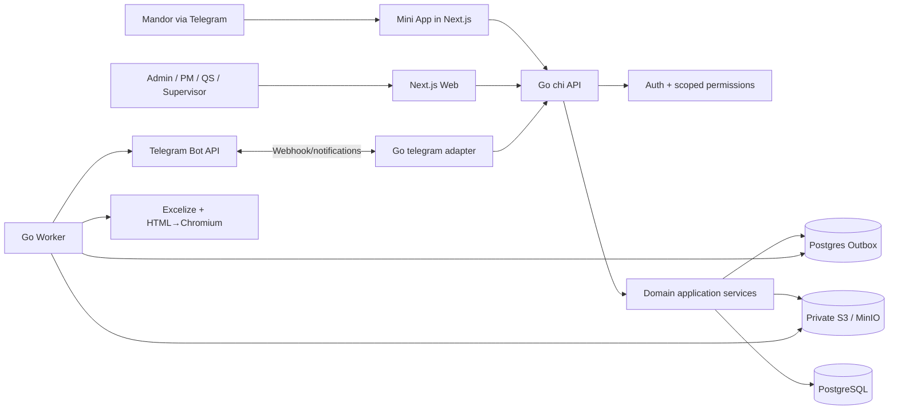
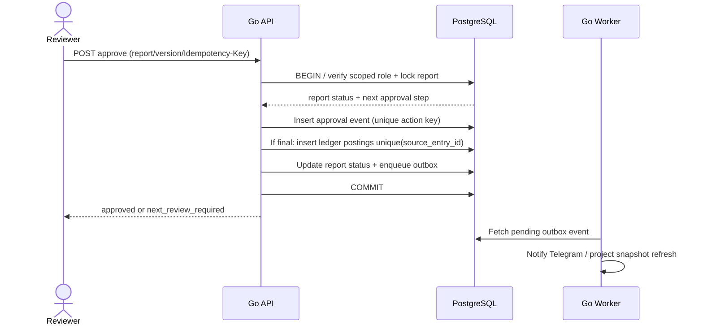
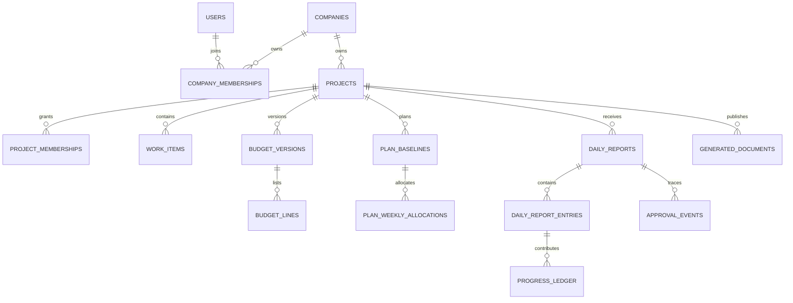

# System Design Document (SDD) — Construction SaaS

**ID:** SDD-001 · **Versi:** 1.0.0 · **Status:** Proposed / bukan implementasi  
**Tech decision:** Next.js frontend; **Go** (`chi`, `pgx`, `sqlc`, `goose`) backend; PostgreSQL; MinIO/S3; Go worker; Telegram. **Tidak pakai Supabase**.  
**Rujukan:** [PRD](../product/PRD.md), [DESIGN](DESIGN.md), [DATA-DICTIONARY](DATA-DICTIONARY.md), [API-CONTRACT](../specs/API-CONTRACT.md)

## 1. Scope & quality attributes

Sistem SaaS B2B multi-tenant yang memproses proyek kontraktor berbagai jenis, alur RAB dan time schedule, laporan harian approved, progress ledger, dashboard, lalu XLSX/PDF resmi. Atribut utama: tenant isolation, integrity, auditability, idempotency, versioned documents, mobile-first field reporting, maintainable modular monolith.

**Pilihan trade-off:** Satu deployment Go API memudahkan transaksi lintas domain; konsisten untuk workflow inti. UI Next.js boleh responsif, tetapi tidak menyimpan business logic perhitungan. Async hanya untuk email/Telegram/pembuatan ekspor/notifikasi; approval/ledger tetap dalam satu transaksi PostgreSQL.

## 2. C4 konteks dan komponen

**Trust boundaries:** browser dan Telegram dianggap tidak tepercaya; Go menegakkan auth, rate limits dan tenant scope; database adalah sumber kebenaran; storage private. Go worker menerima event yang berisi scoped IDs dan memvalidasi context sebelum memproses.

## 3. Module boundaries & ownership

| Go module | Owns | Public internal service operations | Side effects |
|---|---|---|---|
| identity | users, sessions, invitations | Authenticate, CreateInvite, RevokeSession | email notification outbox |
| tenancy | companies, memberships | RequireCompanyRole, ManageMember | audit |
| projects | project, contract, location, WBS | CreateProject, AssignMembers, EditWBS | audit |
| budgets | version, line, mapping, import | StageImport, Validate, ApproveBudget | audit |
| planning | baseline, weekly allocations | CreateBaseline, ApproveBaseline | audit |
| reports | daily report, entries, approvals | Submit, RequestRevision, Approve | audit/ledger orchestration |
| progress | append-only ledger, snapshot | PostApprovedEntries, CalculateProgress | read projections |
| documents | report period, templates, generated files | FreezeSnapshot, Generate, Publish | outbox/export |
| integration | Telegram link & webhook receipts | VerifyMiniApp, LinkAccount, ProcessUpdate | outbox |
| platform | job runs, audit, health | Observe jobs, resolve operational incidents | alerts |

**Dependency rule:** Transport calls application services; domain does not depend on HTTP, Telegram, Excelize or database driver. Shared transactions passed via infrastructure ports, not ad hoc cross-module SQL from handlers.

## 4. Deployment / runtime

- Web container: Next.js static/server-rendered UI and Mini App routes; does **not** expose privileged database secrets.
- API container: Go HTTP server with auth, request ID, validation, permission middleware, security headers, API versioning and webhook route.
- Worker container: Go service polling PostgreSQL outbox with lock/lease; idempotent jobs and bounded concurrency.
- PostgreSQL: private network, migrations by release process, durable backup/PITR policy.
- Object storage: private bucket(s), server-side generated temporary URLs after permission checks; no public uploads.
- Chromium service/process for PDF: sandboxed, network-restricted if possible; untrusted template HTML prohibited.
- Reverse proxy + TLS, secrets store/environment injection; monitoring/logs/health checks.

Compose/VPS is acceptable for pilot with restore drill; no microservices/Kubernetes until measurable need.

## 5. Key transaction sequences

### 5.1 Final report approval

**Invariant:** request retry and concurrent approvals cannot create additional postings; lock/unique constraints; no cross-tenant approval. A failed DB transaction yields no approved status. Outbox may be delivered *at least once*, consumers idempotent.

### 5.2 RAB import

Private upload → metadata verification/size/type limit → import staging → select sheet/header → map columns → parse decimal/localization → classify header/leaf/subtotal → validate duplicate codes, unit, quantity, price, totals → user preview → draft budget version → authorized approve immutable version → optional baseline draft. Spreadsheet formulas are not executed as arbitrary code.

### 5.3 Publishing report

Authorized user selects period → service resolves active approved `budget_version`, `plan_baseline`, `report_template`, timezone, and explicit ledger cutoff → materialize **immutable snapshot** with hash → create job + outbox → worker outputs XLSX and PDF from same snapshot → private object storage → generated document metadata → reviewer publish step → audited signed link. Re-issue is new revision; earlier binary retained by policy.

## 6. Data and physical relationships

See [DATA-DICTIONARY](DATA-DICTIONARY.md) for table-level keys/indexes and [DATABASE](DATABASE.md) for integrity requirements. High-level:

All tenant-owned tables carry `company_id`; project-owned carry `project_id` where relevant. Use composite candidate keys/FKs `(company_id, project_id)` to reject child rows pointing to a project from another tenant. Add unique constraints for idempotency, `NUMERIC` for quantity/price, indexes by tenant/project/date. Default deny in API; RLS optional defense-in-depth behind reviewed ADR, **not presumed implemented**.

## 7. Progress calculation policies

Full formulas: [CALCULATION-RULES](CALCULATION-RULES.md). Money/quantity must be decimal-safe. Contract totals calculated from approved leaf item lines, excluding WBS headers and subtotals. Approved postings append to ledger with `effective_date`. Weekly previous/current/to-date based on period bounds. Planned weekly contribution from approved baseline. Deviation displayed as percentage points. Milestone and verified percent require explicit measurement conversion strategy and approval; do not fake quantities.

**Outstanding design:** define method-specific normalized progress events for `milestone`/`verified_percent` in physical schema, with tests, before implementation. `progress_ledger.qty_delta` alone is insufficient to represent all three methods losslessly. Recommended discriminated fields `measure_kind` plus `quantity_delta` or `progress_point_delta`, constrained by kind. Create an ADR before final migration.

## 8. Security design

- Go auth: Argon2id passwords, hashed opaque session tokens in DB, expiration and revocation; Secure+HttpOnly+SameSite cookies; CSRF protection for cookie-authenticated mutations.
- Authorization: company membership AND project role/permission; consistent `scope` service checks on read, write and object download. Deny unauthenticated except public health and auth endpoints.
- Telegram: one-time expiring link, verify Mini App `initData` HMAC with bot key server-side, check `auth_date` freshness, webhook secret and dedupe update ID. Never trust `initDataUnsafe` or chat IDs as direct permissions.
- Objects: upload limit/allowlist/scanning policy, private namespace, signed URL short TTL. Sanitize filename, prevent CSV/XLSX formula injection on export cell content, escape HTML template values.
- Audit: actor, company, project, action, timestamp, idempotency/ref; redact PII and secrets in structured logs.
- Operations: rate limits, anti-brute-force, secret rotation, backups and recovery tests, tenant data deletion/retention policy.

## 9. APIs and versioning

REST `/api/v1`; authenticated JSON envelope, standardized error codes, pagination, stable idempotency semantics. OpenAPI machine spec (`api/openapi.yaml`) will be authored during implementation; [API-CONTRACT](../specs/API-CONTRACT.md) is human-readable proposal, **not** a completed production contract. Breaking changes require API version or explicit compatible rollout. No direct PostgreSQL access from frontend.

## 10. Observability and operations

Prometheus-style metrics or equivalent: API p95, error rate, webhook replay/drop, outbox lag, export duration/success, postgres pool saturation, per-tenant request/worker quotas as growth warrants. Logs include trace/request ID but no uploaded document content or secret. Health readiness checks DB availability but do not leak config. Require migration plan, rollback/recovery notes, backup and restore drill, and security review before real company data.

## 11. Growth path

Grow: typed custom forms, tenant-branded report templates, actual expenses separate ledger, billing and offline drafts. Scale: read model, cache, DB tuning, worker partitioning with fairness. Enterprise: SSO, complex delegated approval, audit export. Each requires PRD/task update, ADR when needed, tests, and human approval. See [EVOLUTION](EVOLUTION.md).

## 12. Constraints / unresolved decisions

- Official baseline scope, approved budget cross-version repricing and work-in-progress interpretation.
- Rounding/precision policy by numeric domain and localized display.
- Source of legally authoritative sign-off and tax parameterization.
- Performance/SLO from pilot sizes, object retention and private-link expiry.
- Support staff production access workflow and incident controls.

Track in [RISKS-AND-OPEN-DECISIONS](../delivery/RISKS-AND-OPEN-DECISIONS.md); never silently hardcode.
