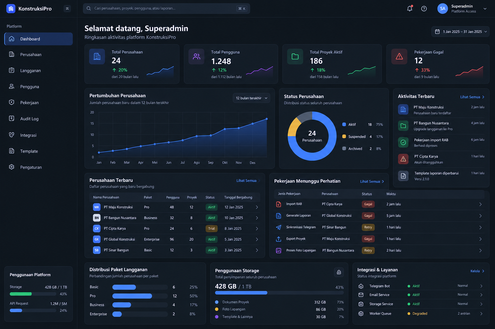

# DESIGN.md — Superadmin

> **Document ID:** DESIGN-SUPERADMIN-001
>
> **Product:** Construction Project Management SaaS
>
> **Area:** Frontend · shell, Dashboard, dan Manajemen Perusahaan Superadmin
>
> **Frontend:** Next.js + TypeScript
>
> **Backend contract:** Golang REST API + OpenAPI
>
> **Design direction:** Enterprise operasional · light/dark · responsive
>
> **UI language:** Bahasa Indonesia (terjemahan Inggris tersedia di implementasi)

Dokumen ini adalah **catatan pola desain yang hidup**, bukan bukti bahwa semua fitur dalam spesifikasi telah dibuat. Saat ada revisi UI, perbarui aturan yang berlaku dan log revisi di §13 dalam perubahan yang sama; jangan biarkan instruksi lama bertentangan dengan implementasi.

## 1. Referensi desain



**File gambar:** `assets/superadmin-dashboard-reference.png`

Gambar ini adalah **referensi visual dashboard yang terlihat sudah jadi**, bukan wireframe dan bukan hasil aplikasi yang sudah terhubung ke backend. Gunakan sebagai arahan komposisi, proporsi, visual hierarchy, warna, kepadatan informasi, dan gaya komponen; **jangan pixel-perfect copy**. Semua nama perusahaan, angka, grafik, status integrasi, dan aktivitas di gambar merupakan **data ilustrasi**, bukan data sistem yang telah diverifikasi.

### Ciri visual yang perlu dipertahankan

- Light dan dark mode menggunakan palet Superadmin sendiri; gambar menunjukkan karakter dark, tetapi bukan alasan mengabaikan light mode. Panel memakai hairline seperlunya; area internal lebih mengandalkan surface, jarak, dan tipografi.
- Sidebar kiri yang stabil, topbar yang ringkas, dan area konten berbasis responsive grid.
- Highlight biru untuk navigasi aktif, visualisasi data, dan tombol aksi utama.
- Typography tajam dengan angka KPI lebih menonjol daripada deskripsi.
- Ikon garis konsisten; **tidak menggunakan emoji untuk UI**.
- Charts, tables, feeds, dan system-health panels yang terasa operasional, bukan dashboard marketing.
- Spacing konsisten, sudut membulat moderat, shadow minimal, dan micro-interaction yang tidak mengganggu.

## 2. Scope dan prinsip desain

Dokumen ini mengatur **shell, Dashboard, dan alur Manajemen Perusahaan** (`/superadmin/companies`: daftar, tambah, detail/tab, edit, Admin, undangan, dan dialog status). Bagian dashboard di bawah adalah panduan desain/kontrak; tidak semua contoh widget atau endpoint merupakan fitur yang telah diimplementasikan. Desain modul lain tidak otomatis termasuk scope. Detail implementasi visual ada di `Construction-Saas-FE/apps/web/components/superadmin/superadmin.css`, kontrol bersama di `components/ui/primitives.tsx` dan `app/globals.css`.

**Prinsip implementasi:**

1. **Backend is source of truth.** Semua nilai dashboard berasal dari API Go; tidak ada angka hardcoded untuk produksi.
2. **Role-aware, permission-aware.** Data dan aksi mengikuti `platform` capabilities yang dikembalikan backend; menyembunyikan tombol di FE bukan mekanisme otorisasi.
3. **Metadata only.** Superadmin mengelola platform; tidak otomatis mendapatkan hak membaca RAB, laporan, dokumen, atau foto perusahaan.
4. **Accessible by design.** Gunakan label, ikon, dan status tekstual; jangan menyampaikan status hanya lewat warna.
5. **Useful over decorative.** Visualisasi harus memberi konteks dan satuan, bukan hanya tampak bagus.
6. **Reuse existing stack.** Hormati desain, komponen, routing, dan auth Next.js yang sudah ada; hindari duplikasi komponen.

## 3. Design tokens

Nilai di bawah menjelaskan **token implementasi saat ini**, bukan sampling spesifikasi brand resmi. Sumber kebenaran nilai aktual adalah `--sa-*` pada `.sa-shell` dan `:root[data-theme="dark"] .sa-shell` di `superadmin.css`; shell memetakan token semantik aplikasi untuk kontrol bersama. Periksa CSS bila ada perbedaan nilai.

### 3.1 Colors — light & dark mode

| Token `--sa-*` | Light / dark | Penggunaan |
|---|---|---|
| `--sa-canvas` | `#f8fafc` / `#0b1220` | Latar halaman |
| `--sa-card` | `#ffffff` / `#111c2e` | Panel dan dialog |
| `--sa-border` | `#e2e8f0` / `#1e2b41` | Hairline panel, kontrol, baris tabel |
| `--sa-ink` | `#0f172a` / `#f1f5f9` | Judul dan teks penting |
| `--sa-subtle` | `#64748b` / `#94a3b8` | Label dan metadata |
| `--sa-blue` | `#2563eb` / `#60a5fa` | Aksi primer, seleksi, fokus |
| `--sa-green` | `#059669` / `#34d399` | Aktif, diterima |
| `--sa-amber` | `#b45309` / `#fbbf24` | Provisioning, menunggu, perhatian |
| `--sa-red` | `#e11d48` / `#fb7185` | Bahaya dan error |

Badge menggunakan varian `--soft` untuk latar; status netral memakai `--sa-hover` dan `--sa-subtle`. Jangan memakai warna tanpa teks status.

**Warna dan makna:** gunakan `primary` untuk seleksi/tindakan utama dan `danger` untuk status gagal atau aksi berbahaya. Jangan memakai merah sebagai variasi biasa dari biru. Target kontras teks normal **≥ 4.5:1**, teks besar **≥ 3:1**, dan batas/indikator penting **≥ 3:1** terhadap background terkait. Verifikasi nilai akhir dengan accessibility testing karena angka di atas merupakan titik awal.

### 3.2 Typography

- Font shell: `var(--font-jakarta)` (Plus Jakarta Sans), fallback `system-ui, sans-serif`; jangan mengganti font hanya karena referensi menyebut alternatif.
- Page heading: `28px / 36px`, weight `700`.
- Section heading: `15–16px / 24px`, weight `600–700`.
- KPI value: `26–30px / 34px`, weight `700`, gunakan **tabular numbers**.
- Body: `14px / 20–22px`, weight `400–500`.
- Table cells: `13px / 20px` untuk desktop dengan densitas sedang.
- Secondary / helper: `12px / 18px`, minimum readable size di viewport kecil.
- Currency/number formatting mengikuti locale aktif (`id-ID` atau `en-US`); tanggal dashboard menggunakan UTC yang ditandai jelas.

### 3.3 Spacing, radius, elevation

- Basis spacing: **4px**; interval umum `4 / 8 / 12 / 16 / 20 / 24 / 32`.
- Page horizontal padding desktop: `24px`; tablet: `20px`; mobile: `16px`.
- Grid gap: `12–16px`; gap antar section: `16–24px`.
- Card padding: `16px`; panel utama: `20px`.
- Radius: panel `--sa-radius-card` (16px), tombol dan kontrol `--sa-radius-control` (12px), hanya badge/search/chip yang sesuai memakai `--sa-radius-pill` (9999px). Tombol Superadmin **bukan pill penuh**.
- Panel memakai hairline 1px `--sa-border`; input dan tombol berkontur bila fungsional; baris tabel memiliki pemisah tipis. Jangan menambahkan garis dekoratif berulang di dalam panel atau memberi batas ganda pada satu kontrol.
- **Satu garis fokus untuk field:** input dan textarea `.ui-field__control` selalu memiliki satu border 1px; saat `:focus`, **warna border yang sama** berubah ke `--focus`, tanpa menambah ketebalan, outline rounded kedua, inset shadow, atau ring pada pembungkus. Tidak ada perubahan ukuran saat fokus. Validasi `aria-invalid` terlihat saat tidak fokus dan pesan error tetap terasosiasi. Kontrol non-field (tombol, tautan, trigger dropdown) tetap memiliki outline fokus; input command palette dikecualikan karena pembungkusnya mengelola fokus.
- Target interaktif minimal 40px di tabel desktop; pertahankan ukuran sentuh yang nyaman di mobile dan penanda fokus keyboard yang jelas di kedua tema.

### 3.4 Icons & motion

- Ikon: **Lucide** atau icon library yang sudah digunakan repo; ukuran umum `16/18/20px`.
- Ikon tanpa label harus memiliki `aria-label` dan tooltip jika maksudnya tidak jelas.
- Interaction transition: `150–200ms ease-out` untuk hover, menu, card emphasis.
- Animasi chart hanya saat mount atau perubahan filter, tidak berulang tanpa alasan.
- Hormati `prefers-reduced-motion`; gunakan fade minimal atau nonaktifkan motion dekoratif.

## 4. Layout architecture

### 4.1 Application shell

| Area | Desktop recommendation | Behavior |
|---|---|---|
| Sidebar | `240px` fixed width | Sticky; scroll internal bila menu panjang |
| Topbar | tinggi `56–64px` | Sticky; memuat pencarian terbatas yang berfungsi, toggle bahasa/tema, dan profil. Jangan tampilkan notifikasi tanpa API |
| Content | Sisa viewport | Width fluid; padding `24px`; min-width tidak memaksa horizontal page scroll |
| Data grid | 12-column responsive grid | Breakpoint-based spans; cards bisa stack |
| Dashboard | Vertical page scrolling | Breadcrumb berada di dalam konten, bukan header; tinggi viewport tidak dipaksa memuat semua widget |

**Contoh komposisi dashboard:** Acuan HTML pengguna menempatkan empat KPI dalam satu baris, tiga panel analitik berproporsi 5:4:3, dua tabel sejajar, lalu tiga panel operasional; responsif menjadi bertumpuk. Contoh data, badge, sparklines, notifikasi, tautan, dan tombol dalam HTML bersifat ilustratif dan **bukan** izin untuk mengarang data atau mengaktifkan aksi tanpa endpoint. Untuk batas panel/kontrol dan fokus, ikuti aturan implementasi mutakhir di §3.3, bukan screenshot lama.

```text
┌─────────────┬────────────────────────────────────────────────────┐
│             │ Topbar: search terbatas, locale, theme, profile     │
│ Sidebar     ├────────────────────────────────────────────────────┤
│             │ Breadcrumb · Page title + subtitle · Date range    │
│ Dashboard   │                                                    │
│ Perusahaan  │ [ KPI 1 ] [ KPI 2 ] [ KPI 3 ] [ KPI 4 ]            │
│ Langganan   │                                                    │
│ Pengguna    │ [ Growth chart      ] [ Status chart ] [ Activity ]│
│ Jobs        │                                                    │
│ Audit       │ [ Recent companies ] [ Jobs needing attention ]    │
│ Integrasi   │                                                    │
│ Template    │ [ Subscription ] [ Storage ] [ Integration ]       │
│ Pengaturan  │                                                    │
└─────────────┴────────────────────────────────────────────────────┘
```

Gunakan komposisi di screenshot sebagai inspirasi; jangan memaksakan jumlah kolom tertentu apabila memengaruhi keterbacaan.

### 4.2 Responsive behavior

| Viewport | Sidebar | Layout | Data tables |
|---|---|---|---|
| `≥ 1440px` | Full sidebar | KPI 4 kolom; analitik multi-panel | Table penuh, action kanan |
| `1024–1439px` | Sidebar compact/collapsible | KPI 2–4 kolom; chart diberi lebar layak | Column priority dan horizontal scroll lokal |
| `768–1023px` | Collapsible drawer | KPI 2 kolom; chart stack bila perlu | Horizontal scroll hanya di tabel |
| `< 768px` | Drawer overlay | KPI 1 kolom atau 2 jika benar-benar muat; panel stack | Compact list/card atau scroll area |

Jangan menurunkan font terlalu kecil untuk mempertahankan empat kolom. Hindari overflow horizontal pada halaman; horizontal overflow lokal boleh pada tabel dengan penanda yang terlihat.

## 5. Navigasi

### Sidebar

- **Dashboard** — route aktif `/superadmin/dashboard`.
- **Perusahaan** — daftar organisasi.
- **Langganan** — subscription dan plan.
- **Pengguna** — platform/account metadata sesuai izin.
- **Proses & Antrean** — background jobs dan retry statuses.
- **Audit Log** — perubahan administratif.
- **Integrasi** — status layanan terhubung.
- **Template** — global report templates.
- **Pengaturan** — global platform settings.

Sidebar menampilkan logo atau wordmark, active indicator biru, ikon, label, dan hover/focus state. Jangan menggunakan label **Pekerjaan** untuk background jobs agar tidak tertukar dengan pekerjaan konstruksi; gunakan **Proses & Antrean**.

### Topbar

- Search hanya aktif untuk fitur atau endpoint pencarian yang memang tersedia; bila belum ada endpoint global, pencarian lokal boleh menyaring data yang benar-benar telah dimuat dengan label cakupan eksplisit (misalnya 5 entri terbaru), dan tidak boleh diklaim sebagai pencarian seluruh platform.
- Notifikasi hanya ditampilkan apabila integrasi notifikasi tersedia.
- Profil menunjukkan nama/peran operator terautentikasi, dengan menu akun dan **Keluar**.
- Date range harus terhubung ke query dashboard; bila belum didukung API, tampilkan konteks waktu statis yang jelas alih-alih dropdown palsu.

## 6. Dashboard content specification

### 6.1 Page header

- Title: **Dashboard Platform** atau **Selamat datang, {nama operator}** (pilih satu yang sesuai produk).
- Subtitle: **Ringkasan aktivitas dan kondisi operasional platform.**
- Date range: preset *7 hari*, *30 hari*, *12 bulan* jika didukung backend, serta rentang custom bila tersedia.
- Layout: heading kiri, kontrol filter kanan; stack di mobile.
- Kontrol filter adalah **satu kluster dengan satu metrik kontrol**: chip periode (`ikon kalender · tanggal awal – tanggal akhir · UTC`) dan picker rentang (`ikon kalender · label preset · chevron`) memakai tinggi, radius, padding inline, dan ukuran font yang sama. Keduanya sejajar secara vertikal dan tidak boleh berbeda tinggi; bila salah satu berubah ukuran, yang lain ikut berubah.

### 6.2 KPI cards — empat kartu

| UI label | Definition | Notes |
|---|---|---|
| **Total Perusahaan** | Jumlah tenant yang tercatat sesuai cakupan filter | Definisikan apakah archived termasuk; total harus konsisten dengan donut |
| **Total Pengguna** | Jumlah akun user unik global | Jangan tertukar dengan jumlah membership |
| **Proyek Aktif** | Jumlah proyek berstatus aktif sesuai aturan domain | Metadata agregat saja |
| **Proses Gagal** | Job gagal dalam periode filter | Jangan diberi label *Pekerjaan Gagal* |

Anatomi kartu: icon badge kiri, label kecil, angka besar, *trend* bila API memberikan baseline pembanding, dan sparkline opsional bila datanya tersedia. Trend **tidak boleh disintesis dari angka current saja**. Untuk error metric, kenaikan merah dan teks **naik**; penurunan hijau dan teks **turun**, jangan hanya panah/warna.

### 6.3 Pertumbuhan Perusahaan

- Visual: line/area chart biru dengan grid horizontal halus.
- Label Y dan tooltip menjelaskan unit **jumlah perusahaan**.
- Tentukan secara eksplisit apakah chart menampilkan *jumlah perusahaan baru per periode* atau *jumlah kumulatif perusahaan*; **jangan campur definisi**.
- Pilihan rentang waktu hanya mengubah chart berdasarkan data API.
- Sediakan state saat belum ada data, data parsial, atau gagal dimuat.
- Untuk screen reader, sertakan ringkasan tekstual/chart data accessible.

### 6.4 Status Perusahaan

- Visual: donut chart dan legend dengan angka/persentase.
- Kategori: **Aktif**, **Ditangguhkan**, **Diarsipkan**.
- Pusat donut: total sesuai kategori yang dihitung.
- Pastikan jumlah tiap kategori konsisten dengan total dan denominator persentase.
- Sertakan nama kategori + angka dalam legend; warna bukan satu-satunya pembeda.
- Jika total `0`, tampilkan empty state, bukan donut palsu.

### 6.5 Aktivitas Terbaru

- Feed informasi operasional: pendaftaran perusahaan, perubahan status, perubahan langganan, kegagalan/keberhasilan proses, perubahan konfigurasi.
- Item: ikon, headline, metadata singkat, relative time dengan tooltip absolute timestamp.
- Kategorisasi activity menggunakan status dan safe description; jangan memunculkan isi data sensitif tenant.
- Klik item menavigasi detail yang tersedia dan diotorisasi.
- Hindari auto-refresh yang menggeser daftar saat sedang dibaca.

### 6.6 Perusahaan Terbaru

Kolom desktop:

| Kolom | Contoh aturan |
|---|---|
| Perusahaan | Nama + monogram/logo fallback |
| Paket | Label dari subscription metadata |
| Pengguna | Jumlah membership yang relevan |
| Proyek | Jumlah proyek perusahaan |
| Status | Badge dengan teks dan warna |
| Bergabung | Tanggal `id-ID`, berdasarkan timezone |
| Detail | Link/ikon navigasi ke halaman perusahaan |

Gunakan pagination API untuk halaman daftar lengkap; dashboard cukup beberapa entri terbaru. Nama panjang harus tetap bisa dibaca melalui tautan/detail atau pembungkusan teks, bukan mengandalkan `title` saja. Jangan memakai status `Trial` sebagai status perusahaan: `Trial` adalah status subscription, sedangkan status perusahaan mengikuti nilai resmi backend (`provisioning/active/suspended/archived`).

### 6.7 Proses Membutuhkan Perhatian

- Judul: **Proses Membutuhkan Perhatian**.
- Menampilkan background job yang gagal atau memerlukan retry/manual action.
- Kolom: **Jenis Proses**, **Perusahaan**, **Status**, **Waktu**.
- Status contoh: *Gagal*, *Menunggu percobaan ulang*, *Perlu penanganan*.
- Gunakan ikon danger untuk gagal; warning untuk retry/pending; sediakan text status.
- Item dapat membuka detail job bila memiliki permission.
- Aksi retry **tidak** otomatis diletakkan di dashboard kecuali endpoint dan permission benar-benar tersedia dan aman.

### 6.8 Distribusi Paket Langganan

- Horizontal bars untuk paket yang benar-benar terdefinisi dari backend.
- Sertakan nama paket, jumlah perusahaan, dan porsi terhadap jumlah subscription yang relevan.
- Jumlah seluruh kategori harus sesuai total yang digunakan sebagai denominator.
- Nama dan warna paket tidak boleh mengasumsikan hanya empat paket selamanya.

### 6.9 Penggunaan Storage

- Total pemakaian + kuota dalam unit konsisten; tampilkan persentase.
- Breakdown per kategori hanya apabila data kategorinya tersedia (misalnya dokumen, foto, template).
- Unit `GB`/`TB` harus memiliki definisi konsisten (decimal atau binary) melalui formatter.
- Jika kuota unlimited, tampilkan **Tanpa batas terkonfigurasi**, bukan `0%` atau membagi dengan nol.
- Bar warna berubah sesuai penggunaan dengan label teks.

### 6.10 Integrasi & Layanan

- Daftar integrasi/layanan yang memang ada: Telegram, email, object storage, worker queue.
- Status: **Sehat**, **Terdegradasi**, **Tidak tersedia**, **Tidak diketahui**.
- Tampilkan health yang dinilai backend, bukan berdasarkan request browser atau dummy interval.
- Beri metadata **Pembaruan terakhir** dan detail singkat bila tersedia.
- `unknown` tidak boleh disamakan dengan `healthy`.

### 6.11 Sidebar usage panel (opsional)

Di bagian bawah sidebar dapat ada ringkasan storage dan API requests. Gunakan hanya bila metrik backend benar-benar tersedia; jangan membuat angka contoh tetap. Jika tidak ada data, **hilangkan panel** untuk mengurangi clutter.

## 7. Shared components

Gunakan atau adaptasi komponen yang sudah ada dalam proyek; nama di bawah bersifat konseptual.

```text
SuperadminLayout
├── SidebarNavigation
├── Topbar
│   ├── SearchTrigger (jika tersedia)
│   ├── NotificationTrigger (jika tersedia)
│   └── OperatorMenu
└── DashboardPage
    ├── DashboardHeader
    ├── DateRangeControl
    ├── KpiGrid
    │   └── KpiCard × 4
    ├── CompanyGrowthChart
    ├── CompanyStatusDonut
    ├── RecentActivityFeed
    ├── RecentCompaniesTable
    ├── AttentionJobsTable
    ├── PlanDistributionPanel
    ├── StorageUsagePanel
    └── IntegrationHealthPanel
```

Komponen reusable wajib memiliki prop yang jelas untuk `data`, `loading`, `error`, `empty`, `onAction`, serta variant ukuran bila memang diperlukan. Hindari satu file dashboard besar yang mencampur UI, fetching, formatting, dan authorization.

## 8. UI states & feedback

| State | Expected behavior |
|---|---|
| Loading | Skeleton menyerupai ukuran kartu/chart/tabel agar layout stabil |
| Empty | Pesan spesifik, misalnya **Belum ada perusahaan terdaftar** |
| API error | Pesan ramah pengguna dan tombol **Coba lagi** yang bekerja |
| Unauthorized (401) | Delegasikan ke auth flow existing, tanpa retry loop |
| Forbidden (403) | Halaman tidak memiliki izin; jangan bocorkan data |
| Partial failure | Widget lain tetap bisa ditampilkan; widget gagal menunjukkan state sendiri |
| Offline/network issue | Tampilkan status dan mekanisme retry yang eksplisit |
| Zero metric | Tampilkan `0` bila backend mengonfirmasi nol; jangan pakai dash |
| Unknown metric | Tampilkan `—` dan penjelasan singkat; jangan pakai `0` |
| Suspended tenant | Tampilkan metadata status; jangan memberi tautan untuk bypass tenant access |

**Status badges:** selalu tampilkan teks (*Aktif*, *Ditangguhkan*, *Diarsipkan*, *Gagal*, *Terdegradasi*). Badge danger (red) hanya untuk gagal/bahaya, badge warning (amber) untuk pending/degraded.

## 9. Data flow & API contract

Existing frontend auth tetap menggunakan Go session/cookie yang telah terintegrasi. Dashboard harus memanfaatkan API client yang sama dan mengacu ke `backend/api/openapi.yaml` sebagai kontrak utama.

**Endpoint yang perlu diverifikasi terhadap implementasi Go:**

| Kebutuhan | Expected contract / source |
|---|---|
| Current operator | `GET /api/v1/platform/me` |
| Platform metrics | `GET /api/v1/platform/dashboard` |
| Recent companies | `GET /api/v1/platform/companies` (filter/sort/page) |
| Attention jobs | `GET /api/v1/platform/jobs` (filter/status/page) |
| Activity feed | Endpoint audit/activities yang benar-benar ada |
| Storage/plan breakdown | Analytics/usage fields dari endpoint yang benar-benar ada |
| Integration health | Endpoint health metadata yang benar-benar ada |

**Jangan menganggap tabel ini sebagai bukti endpoint sudah tersedia.** Periksa OpenAPI dan handler Go yang aktual sebelum implementasi. Jika endpoint/field belum tersedia, tampilkan widget unavailable/empty state yang jelas atau jangan tampilkan widget; dokumentasikan mismatch. Dilarang membuat mock persistence atau fabricated aggregate di produksi.

**Fetching:**

- Gunakan existing React Query/SWR/Server Component conventions dari repo, bukan menambah framework state tanpa alasan.
- Auth/permission tetap authoritative di Go.
- Data private tidak masuk shared/static cache lintas user.
- Dashboard filter dapat disimpan sebagai URL query state jika mendukung deep-linking.
- Re-fetch setelah perubahan yang relevan, dengan cache invalidation scoped yang benar.
- `Intl.NumberFormat('id-ID')` dan `Intl.DateTimeFormat('id-ID')` untuk presentasi lokal.
- Jangan menghitung persentase finansial/kuota dari angka sumber yang tidak konsisten atau missing.

## 10. Accessibility & usability checklist

- Semua navigasi dan dropdown bisa dioperasikan dengan keyboard.
- Focus ring terlihat, berbeda dari hover/selected state.
- Sidebar aktif memakai `aria-current="page"`.
- Tabel memakai header semantik dan alignment angka konsisten.
- Search input memiliki label; icon-only controls memiliki accessible name.
- Text contrast memenuhi WCAG AA setelah tema final diuji.
- Donut/bar/line charts memiliki label atau ringkasan tekstual alternatif.
- Status perubahan tidak bergantung pada warna saja.
- Tooltip tidak menjadi satu-satunya tempat informasi penting.
- Reduced motion dan zoom 200% tidak merusak usability.

## 11. Quality & consistency rules

- Label dan microcopy berbahasa Indonesia; istilah teknis yang umum seperti *API* dan *storage* boleh dipakai jika konsisten.
- Satu sistem ikon, radius, surface, shadow lembut, dan spacing untuk shell, dashboard, dan Perusahaan; batas panel/kontrol dan fokus mengikuti §3.3.
- Date/time selalu memiliki konteks periode/timezone yang jelas.
- Numerik diberi unit; jangan membandingkan *jumlah perusahaan* dan *persentase* di sumbu yang sama tanpa penjelasan.
- Jangan membuat kartu trend palsu, angka bisnis hardcoded, tombol yang tidak bekerja, atau data pelanggan fiktif pada build produksi.
- Jangan memodifikasi desain halaman login yang sudah ada kecuali diperlukan untuk konsistensi shell dan tanpa merusak auth.
- Jangan mencampurkan UI Superadmin dengan dashboard perusahaan/proyek.
- Tidak ada shortcut Superadmin untuk mengubah data RAB, approval, atau progress pelanggan.
- Gunakan asset visual referensi hanya di dokumentasi/desain, **bukan** sebagai gambar yang ditampilkan menggantikan komponen dashboard pada produk.

## 12. UI verification checklist

- [ ] Dashboard mempertahankan karakter operasional referensi di **light dan dark mode** dengan kontras yang baik.
- [ ] App shell, sidebar aktif, topbar, dan user menu konsisten.
- [ ] Keempat KPI menggunakan data dan definisi resmi API.
- [ ] Chart memiliki label, periode, angka, dan accessible alternatives.
- [ ] Data tabel tidak memotong informasi penting tanpa cara membaca detail.
- [ ] Mobile/tablet tidak memiliki page-level horizontal overflow.
- [ ] Komponen mempunyai loading, empty, error, dan permission states.
- [ ] Tidak ada placeholder, random data, atau fake interactivity di produksi.
- [ ] 401/403 dan logout konsisten dengan auth Go existing.
- [ ] UI tidak menampilkan private tenant content secara default.
- [ ] Pengujian keyboard, contrast, responsive, dan TypeScript/lint lolos.

## 13. Pola Manajemen Perusahaan dan protokol revisi

### Pola yang berlaku sekarang

- **Navigasi:** alur daftar → tambah/detail → edit menggunakan breadcrumb di dalam konten. Tab detail menampilkan ringkasan, informasi, proyek, langganan, aktivitas, dan Admin sesuai akses/data yang tersedia. Jangan membuat navigasi atau aksi tanpa permission/endpoint nyata.
- **Identitas dan provisioning:** `id` adalah UUID internal yang unik (relasi dan URL), sedangkan `code` adalah penanda singkat/singkatan perusahaan untuk dibaca manusia. Kontrak saat ini juga mewajibkan `code` unik serta tidak bisa diedit setelah dibuat; jangan samakan keduanya atau mengubah constraint backend tanpa keputusan eksplisit. Kode lama berbentuk `c_` diikuti UUID tanpa tanda hubung dibuat oleh migrasi untuk perusahaan dengan slug yang tidak valid: tampilkan sebagai **kode legacy**, bukan sebagai ID dan jangan mengganti nilainya diam-diam. Pada tab Informasi Perusahaan, tampilkan ID dan kode sebagai dua baris berlabel berbeda. Perusahaan baru tetap `provisioning` sampai Admin pertama menerima undangan. Form tambah meminta `admin_email`; nama Admin pertama tidak diasumsikan tersedia dari kontrak API. Platform permission terpisah dari membership tenant; operator Superadmin tidak otomatis membaca konten bisnis pelanggan.
- **Form dan dialog:** pakai `TextField`/`Dialog` bersama, warna token shell, label dan error terasosiasi; textarea alamat serta alasan penangguhan memakai `.ui-field__control`. Dialog terpusat di viewport dengan CSS `.sa-shell .ui-dialog`; jangan memindahkan dialog ke area flex halaman. Aturan fokus **satu border yang berganti warna** di §3.3 berlaku pada field daftar, form, dan dialog. Pada form Perusahaan, tautan Batal dan tombol Simpan/Buat memiliki tinggi, padding vertikal, font, dan baseline yang sama; lebar mengikuti panjang label, bukan dibuat sama lebar.
- **Daftar:** search berbentuk rounded/pill dan disertai label; filter/sort memakai `Dropdown`. Tabel bisa digeser horizontal **di area tabel saja**, tanpa tinggi tetap atau overflow halaman. Footer menampilkan rentang hasil, total perusahaan, pilihan 10/20/50/100 baris (menu membuka ke atas), serta nomor halaman dan navigasi. Pagination/filter benar-benar menggunakan API; patuhi batas offset backend 10000.
- **Aksi dan status:** kolom aksi tabel rata tengah dengan ikon bermakna, area klik 40px, `aria-label` spesifik objek; hover bukan pengganti nama aksesibel. Tombol biasa radius 12px, badge status tetap pill. Teks status dan warna tampil bersama: aktif/diterima hijau, provisioning/menunggu/ditangguhkan amber sesuai konteks, kedaluwarsa/dibatalkan/dihapus netral. Baris Admin lebih padat secara vertikal; header “Aksi” dan ikon kirim ulang/batalkan undangan sejajar. Aksi sensitif tetap memakai dialog konfirmasi.
- **State dan tema:** tampilkan loading/empty/error/forbidden sesuai data dan izin; pertahankan terjemahan UI, dark/light, keyboard, viewport 390px dan 1440px. Jangan mengarang data atau memakai akses platform untuk melewati isolasi tenant.

### Cara mencatat setiap revisi berikutnya

1. **Identifikasi cakupan:** sebut halaman/komponen, kondisi normal/fokus/error, tema, breakpoint, dan masalah yang ditunjukkan pengguna; bedakan observasi screenshot dari asumsi.
2. **Ubah aturan utama di dokumen ini** ketika pola berubah; jangan hanya menambah catatan baru sementara aturan lama masih bertentangan. Cocokkan dengan `superadmin.css`, `globals.css`, primitive, dan kontrak API yang benar-benar ada.
3. **Tambahkan baris log** dengan tanggal, permintaan → keputusan pola → lokasi kode → bukti verifikasi/batasnya. Catat hanya yang sudah dikerjakan; usulan yang belum dibuat harus diberi label *belum diimplementasikan*.
4. **Periksa regresi** pada kontrol sejenis, light/dark, keyboard, mobile/desktop, empty/error/permission, lalu jalankan TypeScript, lint, build, tes relevan, dan `git diff --check`. Jika sesi autentik tidak tersedia, tulis batas verifikasi visual secara eksplisit.

| Tanggal | Revisi pengguna → pola yang diputuskan | Lokasi / verifikasi |
|---|---|---|
| 2026-10-28 | Alur Perusahaan harus senada dengan dashboard → breadcrumb, radius tombol moderat, search rounded, tabel ber-scroll lokal, pagination bernomor dan menu ukuran baris ke atas. | `company-breadcrumbs.tsx`, `company-list.tsx`, `company-pagination.tsx`, `superadmin.css`; lihat pengujian daftar/pagination. |
| 2026-10-28 | Dialog dan tabel Admin perlu rapi → dialog viewport-centered; aksi ikon berlabel terpusat, baris lebih padat, status akun/undangan berupa badge teks + warna. | `company-detail.tsx`, `company-shared.tsx`, `superadmin.css`; sebelumnya diverifikasi lewat pratinjau statis dan tes terkait, bukan sesi Superadmin nyata. |
| 2026-10-28 | Koreksi fokus field: bukan menebalkan stroke 1px menjadi 2px, melainkan **mengganti warna border 1px yang sama** saat fokus tanpa outline kedua atau perubahan ukuran; search rounded juga mengikuti ini. | `app/globals.css`, `superadmin.css`; pratinjau statis light/dark 1440px dan 390px: border fokus 1px, outline none, tanpa overflow halaman. |
| 2026-10-28 | Tombol Batal/Simpan harus sejajar dan sama tinggi; ID perusahaan (UUID internal) berbeda dari kode singkat perusahaan. Kode tetap unik dan immutable menurut kontrak sekarang; kode `c_…` lama adalah hasil migrasi, bukan ID. | `company-form.tsx`, `company-detail.tsx`, `locale.ts`, `superadmin.css`; pratinjau statis mengukur kedua tombol 40px dengan top sama di desktop/mobile dan cek kontrak migrasi `00017_company_management.sql`. |

---

**Design intent:** hasil akhir harus terasa seperti **produk SaaS enterprise yang sudah siap dipakai**, mengambil sistem visual dari screenshot lampiran, sambil tetap membiarkan implementasi Next.js membuat keputusan layout dan komponen yang paling sesuai dengan data nyata dan desain sistem existing.
