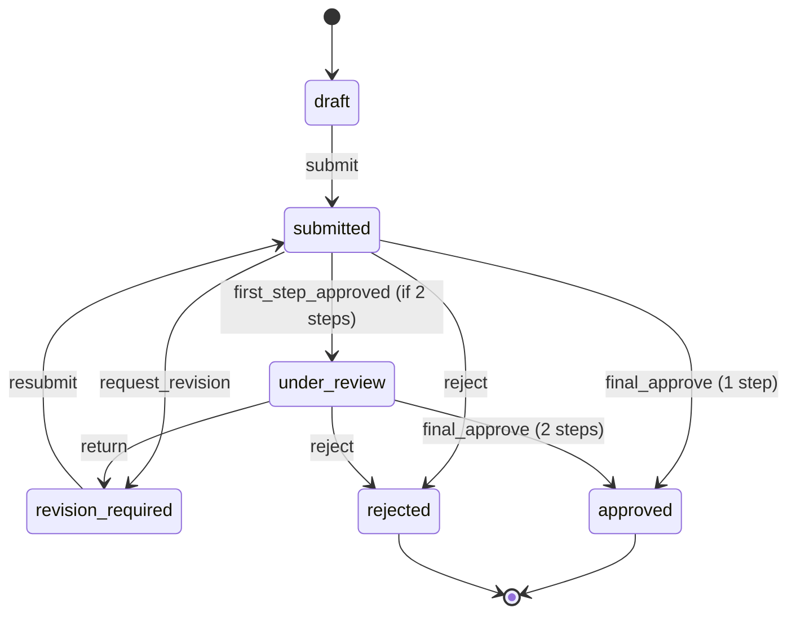

# Domain State Machines & Transaction Rules

**Status:** Proposed · **Applies:** reports, RAB, baseline, export, import.  
**See:** [PRD](../product/PRD.md), [API-CONTRACT](API-CONTRACT.md)

## 1. Daily report lifecycle

| Event | From | To | Invariant |
|---|---|---|---|
| save | draft/revision_required | same state | Reporter may change only own allowed fields |
| submit | draft/revision_required | submitted | Nonempty entries, project access, valid attachments |
| first approve | submitted | under_review | Only configured reviewer step; append event |
| return | submitted/under_review | revision_required | Mandatory reason; increments report revision when resubmitted |
| reject | submitted/under_review | rejected | Reason persisted; never post ledger |
| final approve | submitted/under_review | approved | Unique postings to ledger in same DB transaction |
| correction | approved | approved (unchanged) | New append-only correction record; never mutate original posting |

Conflict handling: report revision and approval step checked under lock/optimistic concurrency. Two reviewers cannot concurrently advance same step twice. Submitted payload immutability enforced; revision starts new content version. `rejected` reopening policy is deferred; create new report if needed.

## 2. Budget version lifecycle

`draft → in_review → approved | rejected`. Approved version immutable; addendum starts new draft with incremented `version_no`, reason and effective date. Budget must pass zero-denominator and leaf-item validation. Changes to work item unit/method after approval require controlled migration / new version.

## 3. Plan baseline lifecycle

`draft → in_review → approved | rejected`; approved baseline immutable, tied to budget version and calendar configuration. Distribution validation includes date ordering, weeks crossing month/year, and sum contribution policy. New baseline supersedes for future reports, never rewrites earlier snapshots.

## 4. Import job lifecycle

`uploaded → mapping_required → parsed → validated → previewed → finalized | failed | cancelled`. Finalize must be explicitly requested by authorized QS, idempotent, and produce only **draft** budget.

## 5. Generated document lifecycle

`requested → snapshot_frozen → rendering → generated → published | failed`. Publish via allowed sign-off steps. Re-render after source change is a **new revision** with new snapshot hash, not a silent replacement of file. Both XLSX/PDF generated from exact same canonical numeric snapshot.

## 6. Telegram integration

`unlinked → link_token_issued → linked → revoked`; issued token short-lived and one-time. Telegram webhook update dedupes before action; bot identity never authorizes work without current internal membership/role.

## 7. Retry and rollback semantics

- Mutation keys scoped to `{company, operation, resource, actor}`; same key + different payload = conflict.
- Ledger and report approval events commit atomically; externally delivered notifications use outbox and may retry.
- On failed report export, retain snapshot and failure record; job may retry without creating duplicate published artifact.
- Cancelled/failed import doesn't damage approved budget.
